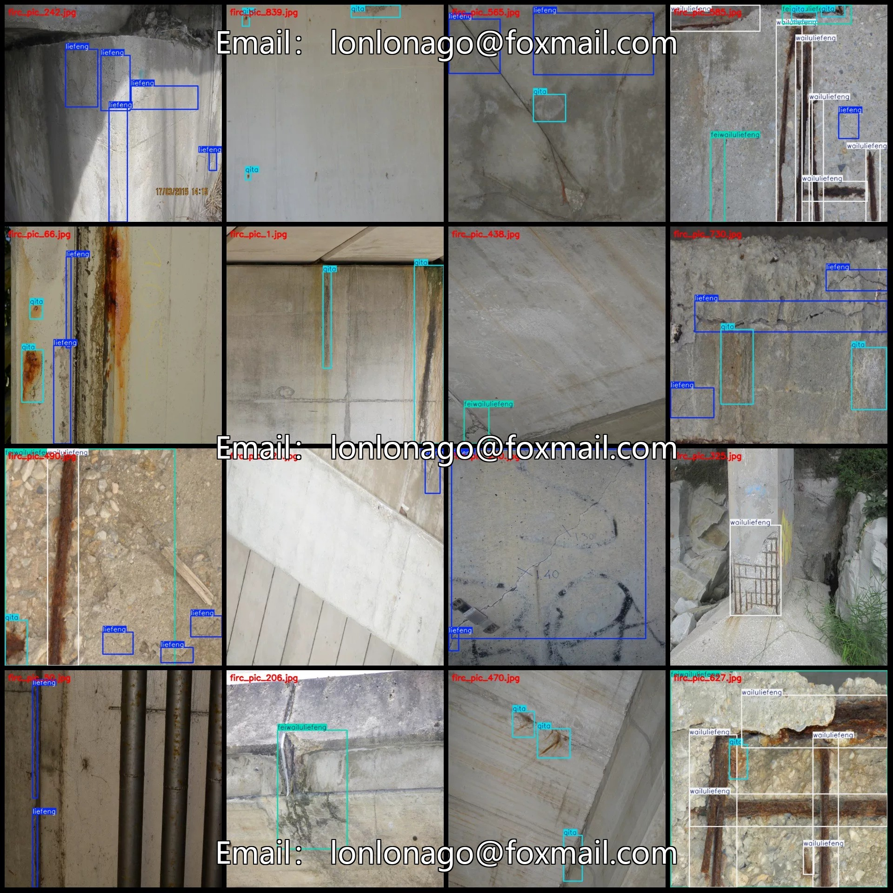
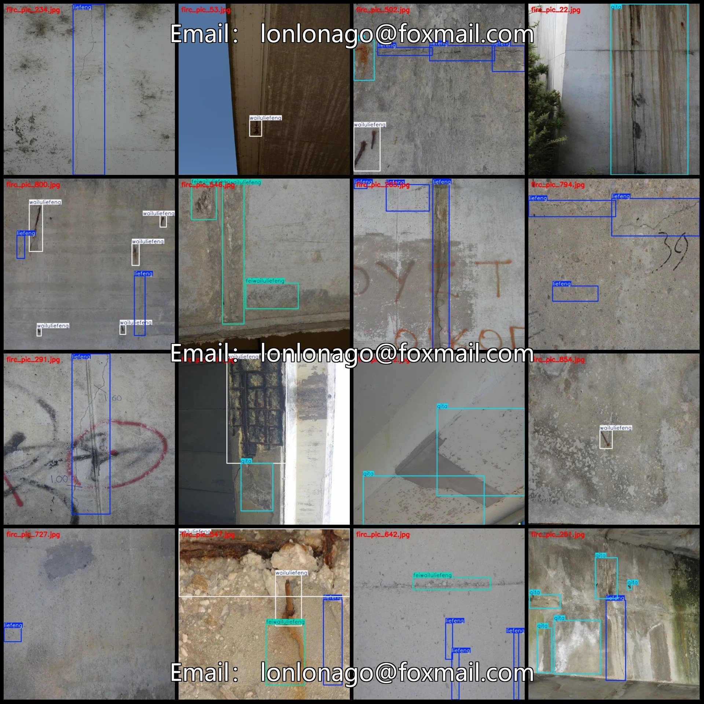
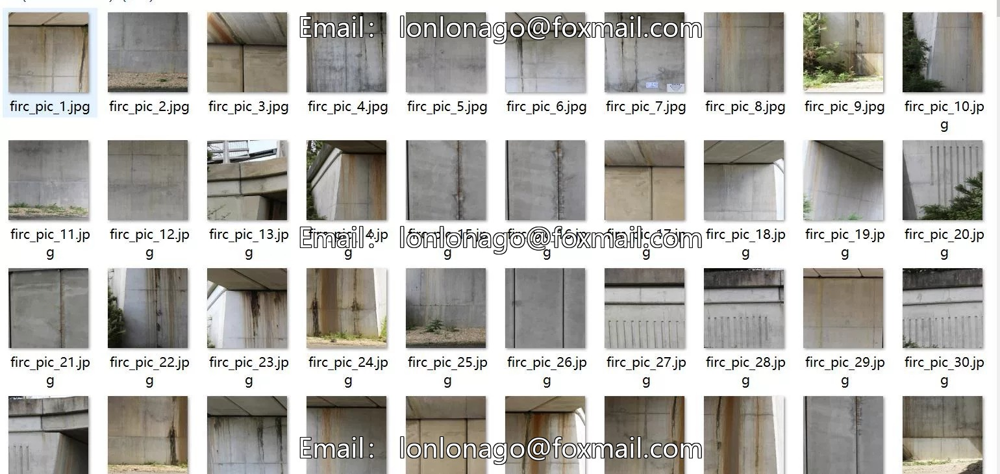
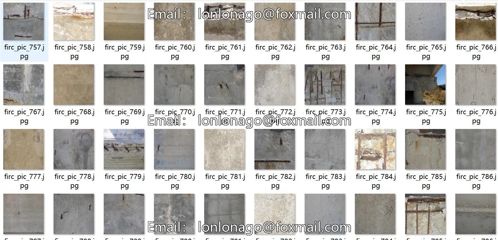
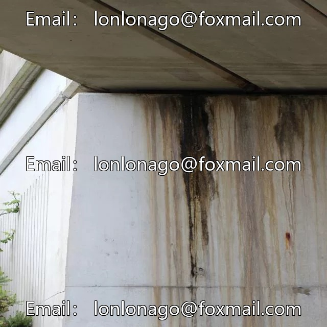
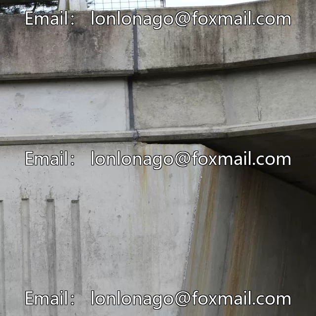
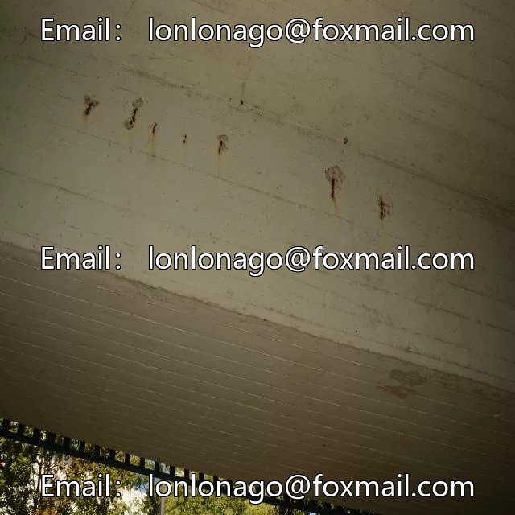

# UAV Viewpoint Low-altitude Aerial Photography Dataset for Bridge Crack Detection in VOC+YOLO format 87

## Body

Drone-Viewpoint Low-Altitude Aerial Photography Dataset for Bridge Crack Detection - VOC+YOLO Format - 877 Images in 4 Categories
Warm Reminder: Due to the dataset's replicability, please confirm compliance with requirements before purchasing.
Please note that different people may have varying opinions. Some might consider images not taken by drones, which can be considered based on the provided images below. After purchasing, it represents agreement to view these as drone-viewpoint images.
Dataset Format: Pascal VOC format + YOLO format (txt file without split paths, only containing jpg images and corresponding VOC format xml files and yolo format txt files)
Number of Images (Total jpg Files): 877
Number of Annotations (Total xml Files): 877

Number of annotations (txt file count): 877
Number of annotation categories: 4
Annotation category names (Note that the order in yolo format does not correspond to this, but is based on the classes.txt in the labels folder): ["feiwailuliefeng", "liefeng", "qita", "wailuliefeng"]
Corresponding Chinese category names: ["Non-exposed cracks", "Cracks", "Other", "Exposed cracks"]
Number of bounding boxes per category
For "feiwailuliefeng": 563
For "liefeng": 1822
For "qita": 971

Wailuliefeng Frames = 855
Total Frames: 4211
Number of Images per Category
Feiwailuliefeng Frames = 264
Liefeng Frames = 549
Qita Frames = 415
Wailuliefeng Frames = 345
Image Resolution: 640x640
Labeling Tool: labelImg
Labeling Rules: Draw a rectangle around the category.
Important Note: The dataset does not have separate training, validation, or test sets; you will need to manually divide them.
Special Remark: This dataset does not guarantee the accuracy of the trained models or weight files.

## Images

## Payment

Here is a pay link on Stripe ( https://buy.stripe.com/3cs8yP7sY87d0vu9AB ). Please contact me lonlonago@foxmail.com after funding $89, and I will send you a complete data files , thank you!

